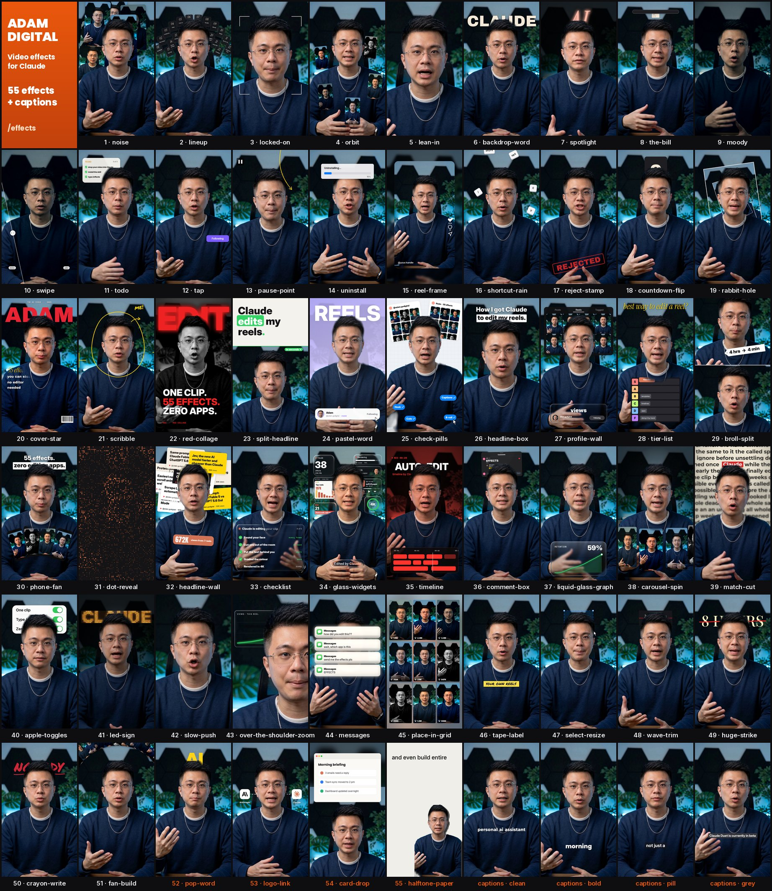

# Gemini Reel Effects (for Google Antigravity & Gemini CLI)

Drop your talking-head video into **Google Antigravity** (or Gemini CLI / Claude Code) and type `/effects`. You get **55 face-tracking video effects**, **word-by-word captions**, **procedural sound effects**, **automatic pause trimming**, plus a **Multi-Provider Image Engine** (free stock search via **Pixabay / Pexels / Wikimedia**, or AI image generation via **Google AI Studio / Gemini / Imagen**, **OpenAI**, **OpenRouter**, **Together AI**, **Fal.ai**, and keyless **Pollinations.ai**).

> **Original Credits & Attribution**
> - **Original Reel Effects Pack**: Created by **Adam Digital** ([@adam.godigital](https://instagram.com/adam.godigital) — [github.com/adamgodigital/claude-reel-effects](https://github.com/adamgodigital/claude-reel-effects)), who built the captions, pause trimming, sound effects, profile setup, and the `pop-word`, `logo-link`, `card-drop`, and `halftone-paper` effects.
> - **Base Effects Engine**: Based on `claude-video-effects` by **Vibha Ramprakash** (MIT).
> - **Gemini & Antigravity Edition**: Adapted by **Rian Yunandar** ([@rianyunandar](https://github.com/rianyunandar)) with cross-platform Windows PowerShell setup (`scripts/setup.ps1`) and the multi-provider image search & AI generation engine (`scripts/images.py`).



---

## Install (One Line)

### For Google Antigravity / Gemini CLI
Open your terminal and paste:

**macOS / Linux:**
```bash
git clone https://github.com/rianyunandar/gemini-reel-effects ~/.gemini/skills/gemini-reel-effects
```

**Windows (PowerShell):**
```powershell
git clone https://github.com/rianyunandar/gemini-reel-effects "$HOME\.gemini\skills\gemini-reel-effects"
```

*(Also compatible with `~/.claude/skills/effects` if you use Claude Code).*

---

## Multi-Provider Image Search & AI Generation (`scripts/images.py`)

Effects that display visual cards or B-roll (`card-drop`, `broll-split`, `orbit`, `noise`, `phone-fan`, `profile-wall`, `carousel-spin`, `place-in-grid`, `check-pills`, `fan-build`) can automatically search for free photos or generate AI visuals when you don't have a local screenshot ready:

### 1. Free Stock Image Search (Pixabay / Pexels / Wikimedia)
- **Pixabay (Free)**: Set `PIXABAY_API_KEY` in `.env` (get a free key at [pixabay.com/api/docs](https://pixabay.com/api/docs/)).
- **Pexels / Wikimedia**: Uses `PEXELS_API_KEY` or falls back automatically to keyless Wikimedia Commons.
- **In your `<video>_effects.json` plan**:
  ```json
  {"fx": "card-drop", "start": 3.0, "end": 6.5, "image_search": "tokyo neon street", "provider": "pixabay", "fit": "cover"}
  ```
  or shorthand prefix:
  ```json
  {"fx": "broll-split", "start": 4.0, "end": 7.5, "images": "pixabay:modern workspace laptop", "text": "4 hrs → 4 min"}
  ```

### 2. Google AI Studio Key (`GEMINI_API_KEY` / `GOOGLE_AI_STUDIO_KEY` / `GOOGLE_API_KEY`)
- Generate custom visuals using your Google AI Studio credits (`gemini-2.5-flash-image-preview`, `gemini-2.0-flash-exp-image-generation`, or `imagen-3.0-generate-002`).
- **In your `<video>_effects.json` plan**:
  ```json
  {"fx": "card-drop", "start": 3.0, "end": 6.5, "image_prompt": "futuristic glowing AI dashboard dark UI", "provider": "google", "fit": "cover"}
  ```
  or shorthand prefix: `"image": "google:futuristic glowing AI dashboard"`.

### 3. Other AI API Keys (OpenAI, OpenRouter, Together, Fal.ai, or Free Keyless Pollinations)
- Supported providers:
  - `google` (`GEMINI_API_KEY` / `GOOGLE_AI_STUDIO_KEY` / `GOOGLE_API_KEY`)
  - `pixabay` (`PIXABAY_API_KEY` — free stock search)
  - `pexels` (`PEXELS_API_KEY` — free stock search)
  - `openai` (`OPENAI_API_KEY` — `dall-e-3` / `gpt-image-1`)
  - `openrouter` (`OPENROUTER_API_KEY` — `google/gemini-2.5-flash-image-preview`, Flux, etc.)
  - `together` (`TOGETHER_API_KEY` — `black-forest-labs/FLUX.1-schnell`)
  - `fal` (`FAL_KEY` — `fal-ai/flux/schnell`)
  - `pollinations` (100% free AI generation, no API key needed)
  - `wikimedia` (100% free photo search, no API key needed)
  - `agy` (Antigravity CLI built-in `image-generator`)
- You can also pass `"api_key": "YOUR_KEY"` and `"model": "MODEL_NAME"` directly inside any effect object or CLI command:
  ```bash
  python scripts/images.py --doctor
  python scripts/images.py --search "coding setup" --provider pixabay --count 4 --out ./cards
  python scripts/images.py --generate "3d gold trophy icon" --provider google --api-key YOUR_KEY --out card.png
  python scripts/images.py --generate "minimalist analytics chart" --provider openai --api-key YOUR_KEY --out card.png
  ```

---

## Use It

1. Open Antigravity or Gemini CLI.
2. Drag your talking-head video into the chat.
3. Type what you want:

```text
/effects full edit
/effects captions
/effects cut the pauses, then add bold captions
/effects logo-link with Gemini and Notion when I say "Notion"
/effects pop-word FREE when I say "free"
/effects card-drop with google:futuristic AI dashboard from 8 to 12 seconds
/effects broll-split with pixabay:coding laptop from 4 to 8 seconds
```

## What You Get

- **55 effects** that track your face. Anything that would cover your face goes behind your head.
- **Word-by-word captions** in 4 styles: `clean` (white words, keywords in gold serif italic), `bold` (one big word at a time, yellow keywords), `pill` (short phrases on a dark pill) and `grey` (small grey-pill subtitles).
- **Pause trimming.** Cuts the silences, keeps a natural breath between lines and keeps your normal pace.
- **Sound effects.** Quiet pops and ticks as effects land, made in code (no sound files to license).
- **Real brand logos.** 109 built in (Gemini, Claude, Anthropic, Perplexity, Meta, GitHub, Notion, WhatsApp, YouTube and more) for `logo-link`, and brand colours for `pop-word`.
- **Multi-provider image search & AI generation.** Fetch B-roll or cards via Pixabay, Google AI Studio, OpenAI, OpenRouter, Together, Fal.ai, or Pollinations.

## The 55 Effects

| # | Type this | What happens |
|---|---|---|
| 1 | `noise` | Reels pile up behind your head |
| 2 | `lineup` | Numbered tiles fan out above your head |
| 3 | `locked-on` | Brackets lock onto your face and the camera follows you |
| 4 | `orbit` | Your reels circle your head, behind you at the top |
| 5 | `lean-in` | A quick punch-in on one word |
| 6 | `backdrop-word` | A giant word drops in behind you |
| 7 | `spotlight` | Kill the lights, keep you lit |
| 8 | `the-bill` | Your instructions print out like a receipt |
| 9 | `moody` | A moody colour grade |
| 10 | `swipe` | A before and after slider |
| 11 | `todo` | A checklist beside your head that ticks off as you talk |
| 12 | `comment-box` | An Instagram comment types itself and posts |
| 13 | `tap` | A Follow button flips to Following |
| 14 | `pause-point` | Freeze frame with a hand-drawn arrow |
| 15 | `uninstall` | A glitchy uninstall bar breaks the frame |
| 16 | `reel-frame` | Your video shrinks into a reel card |
| 17 | `shortcut-rain` | Keyboard keys rain down behind you |
| 18 | `reject-stamp` | A big red stamp slams down |
| 19 | `countdown-flip` | A 3, 2, 1 flip clock above your head |
| 20 | `rabbit-hole` | The room tunnels away behind you |
| 21 | `cover-star` | You become a magazine cover |
| 22 | `scribble` | Marker doodles draw themselves around you |
| 23 | `glass-widgets` | Frosted glass widgets and mini artifacts float around your head |
| 24 | `red-collage` | Black and white you, a giant red word behind, three lines slam in |
| 25 | `split-headline` | A headline card slides down and pushes you to the bottom half |
| 26 | `pastel-word` | Lavender room, a giant word behind you, a profile card gets followed |
| 27 | `check-pills` | Grid-paper room, your reels pinned behind you, blue pills get clicked |
| 28 | `timeline` | A dark red film look with an editing timeline and a glowing playhead |
| 29 | `headline-box` | A punch-in with a clean two-line headline |
| 30 | `profile-wall` | Your reels grid fills the wall while a counter ticks up |
| 31 | `tier-list` | A tier list drops in and flies into S tier |
| 32 | `broll-split` | B-roll on top with a price-tag sticker, you below |
| 33 | `phone-fan` | Your reels fan out like a hand of phones |
| 34 | `dot-reveal` | Your shot builds out of glowing dots, then snaps into focus |
| 35 | `headline-wall` | Your headlines pile up behind your head, then a total pops in front |
| 36 | `checklist` | A task list under your chin, each step ticks green |
| 37 | `liquid-glass-graph` | A liquid glass card with a graph that climbs and a number that counts up |
| 38 | `carousel-spin` | Your reels spin around you in a 3D carousel |
| 39 | `match-cut` | News pages cut on one word, locked in place behind your head |
| 40 | `apple-toggles` | iPhone switches flip on under your chin, one line at a time |
| 41 | `led-sign` | The lights drop and a glowing LED sign types itself out behind you |
| 42 | `slow-push` | A slow cinematic push-in while the room melts out of focus |
| 43 | `over-the-shoulder-zoom` | Pushes into one corner, a liquid glass graph pops beside your head, then the other corner with a second graph |
| 44 | `messages` | iMessage notifications pop in one after another with a soft glow |
| 45 | `place-in-grid` | You shrink into the centre of your 3x3 profile grid, your reels pop in around you with view counts |
| 46 | `tape-label` | A strip of yellow tape with your line lands on your chest |
| 47 | `select-resize` | A blue selection box grabs your number and a cursor drags it bigger |
| 48 | `wave-trim` | The silent parts of your voice are trimmed away on screen until only your words are left |
| 49 | `huge-strike` | One huge serif word fills the wall behind you, then a red line crosses it out |
| 50 | `crayon-write` | A red crayon writes your word behind your head, then underlines it |
| 51 | `fan-build` | Your reel covers deal into a fan behind your head, one card at a time |
| 52 | `pop-word` | A huge bold word pops in behind your head, in a brand colour, yellow or white |
| 53 | `logo-link` | Two real brand logos pop in beside your face, joined by a dashed line that runs behind your head |
| 54 | `card-drop` | You slide down and a floating card with your screenshot/AI image pops in above you |
| 55 | `halftone-paper` | A cream paper page with you cut out bottom-right, your words building at the top in red serif keywords |
| + | `captions` | Word-by-word captions in `clean`, `bold`, `pill` or `grey` |

Bonus looks: `/effects glitter-spotlight` (golden rays and sparkles), `cover-star look=editorial` (a classic magazine cover) and `liquid-glass-graph look=bento` (a glass dashboard around you).

---

## Credits

- **Effects engine**: Based on `claude-video-effects` by **Vibha Ramprakash** (MIT).
- **Adam Digital Video Effects Pack**: Captions, pause trimming, sound effects, profile setup, and the `pop-word`, `logo-link`, `card-drop`, and `halftone-paper` effects by **Adam Digital** ([@adam.godigital](https://instagram.com/adam.godigital) — [github.com/adamgodigital/claude-reel-effects](https://github.com/adamgodigital/claude-reel-effects)).
- **Gemini Reel Effects (Antigravity Adaptation & Multi-Provider Image Engine)**: Adapted by **Rian Yunandar** ([@rianyunandar](https://github.com/rianyunandar)), adding `scripts/images.py` (Pixabay, Pexels, Wikimedia, Google AI Studio / Gemini / Imagen, OpenAI, OpenRouter, Together, Fal.ai, Pollinations, Antigravity CLI) and Windows PowerShell setup (`scripts/setup.ps1`).
- **Models & Assets**: Face tracking: OpenCV YuNet (MIT). Person cut-out: MediaPipe Selfie Segmenter (Apache 2.0). Word timing: faster-whisper (MIT). Brand logos: Simple Icons (CC0); the logos are trademarks of their owners. Fonts: Archivo Black, Instrument Serif, Space Mono, Inter, Anton, Montserrat, Playfair Display, Poppins (SIL OFL) and Permanent Marker (Apache 2.0); licences are in `fonts/`. Everything else: MIT, see `LICENSE`.
